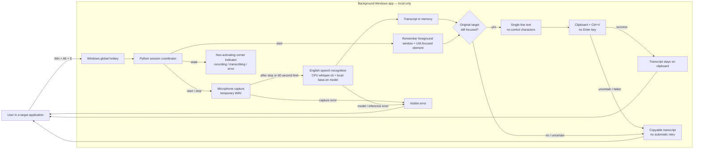
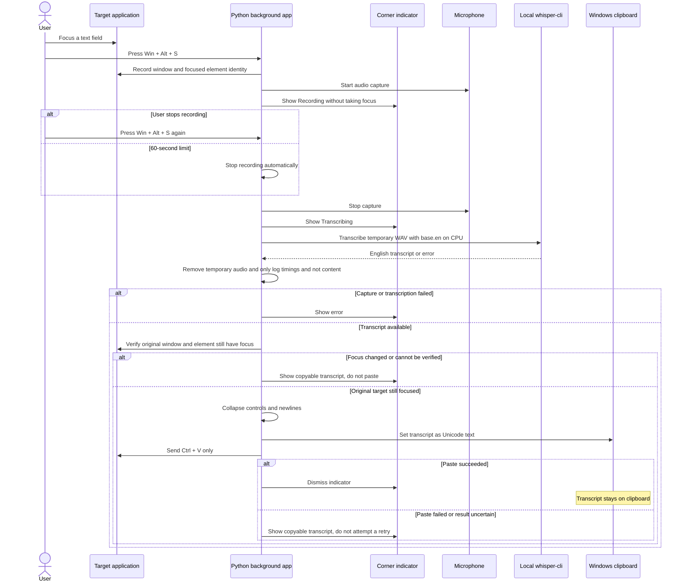

# Offline dictation MVP — architecture

This is the architecture for Windows 11 personal dictation. All processing remains on the PC; setup can fetch the model and runtime once, but dictation has no cloud dependency. The runtime is a Python 3.13 background process, started from a `uv`-managed virtual environment. It records a temporary WAV for a CPU-only `whisper-cli` invocation per utterance. Application data lives under `~\.yat` (`%USERPROFILE%\.yat`): models in `models\`, the CLI in `bin\`, temporary audio in `tmp\`, and logs in `logs\`. The text remains on the clipboard after insertion.

## Dictation sequence

**Safety boundary:** the corner indicator never becomes the input target; the transcript is never sent to a cloud service. Test terminal paste to confirm that text stays editable and no command is submitted. If focus or paste success cannot be verified, prefer a copyable result over guessing. Audio is temporary, with orphan cleanup on the next launch; there is no history.

**Diagnostics boundary:** structured local logs record stage durations, state changes, and sanitized errors. They exclude audio, transcript text, clipboard data, field contents, and window titles. `ruff`, `ty`, and `pytest` are required development checks; packaging is deferred.
